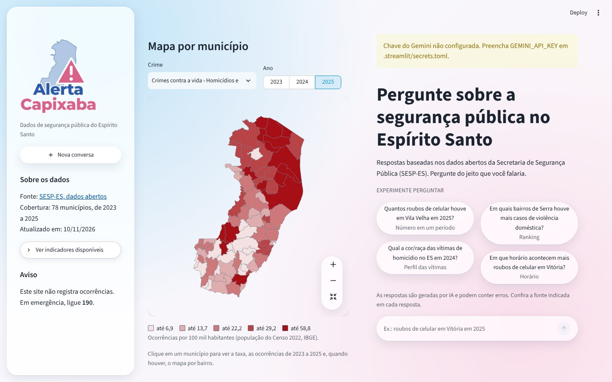
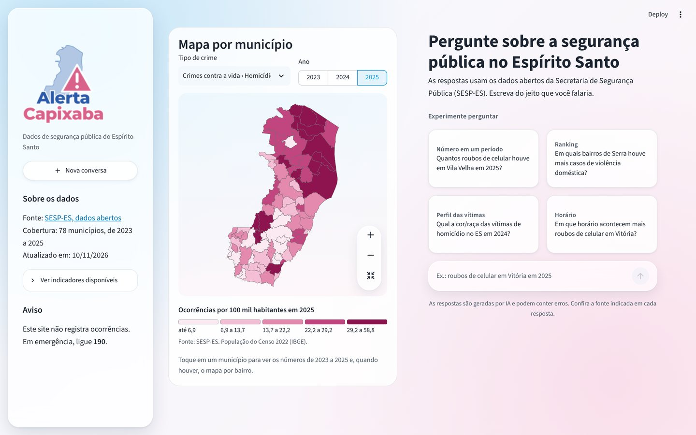
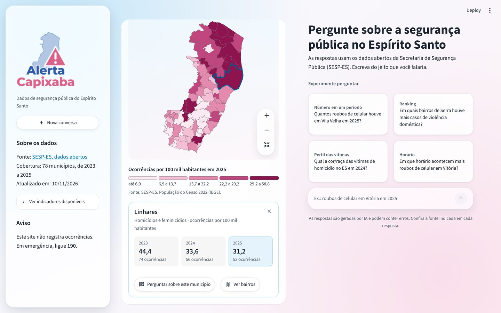
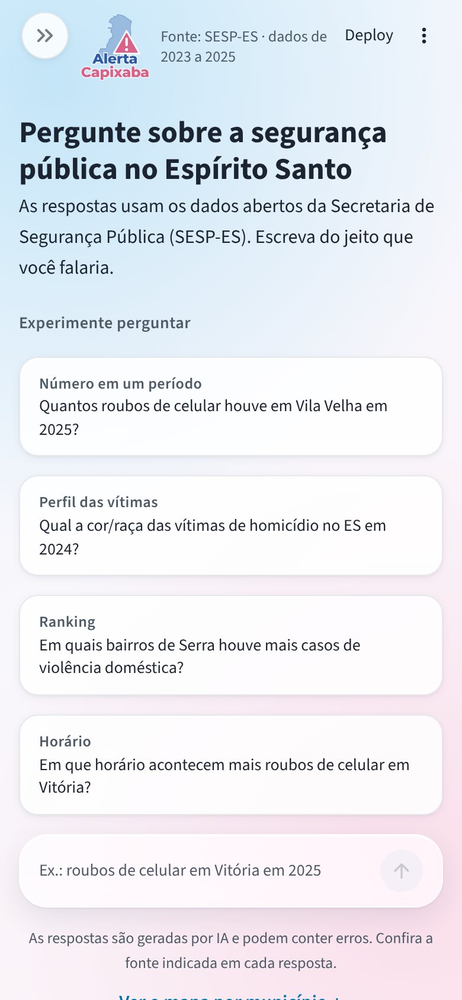

# Relatório de refinamento da interface do Alerta Capixaba

Este relatório documenta o refinamento de UI/UX feito no protótipo, para uso no TCC II. As medidas marcadas como **medido** foram obtidas com o Chromium (Playwright) em uma janela de 1440×900, com o aplicativo rodando localmente; as marcadas como **estimado** não foram medidas.

| Antes | Depois |
|---|---|
|  |  |

| Município selecionado | Celular (390 px) |
|---|---|
|  |  |

## 1. Diagnóstico inicial

- **Estrutura.** `app.py` (418 linhas) concentrava toda a interface; `dominio/`, `dados/` e `infra/` já separavam a lógica; o CSS já estava em `styles.css`.
- **Layout.** O layout real é de duas colunas (mapa e conversa lado a lado) com barra lateral flutuante, e não de coluna única. Esse layout foi mantido.
- **Premissa do mapa.** Confirmada: é um coroplético `go.Choropleth` por município (78 feições, taxa por 100 mil habitantes, 5 classes por quantil). Os dados trazem município e bairro. Há malha do IBGE para os 78 municípios e malha de bairros para 17 deles (832 bairros). O detalhamento por bairro já existia e foi mantido.
- **Problemas de contraste.** Texto branco sobre `#0096E1` tem contraste 3,3:1 (abaixo do AA, que pede 4,5:1). O anel de foco rosa `#F09BBE` sobre branco tem 2,0:1 (abaixo de 3:1).
- **Problemas de desempenho.** Listados na seção 4.

## 2. O que mudou

### 2.1 Organização do código

| Arquivo | Papel |
|---|---|
| `app.py` | Composição: carga com cache, layout das duas colunas |
| `ui/base.py` | Injeção do CSS, cabeçalho e barra lateral |
| `ui/mapa.py` | Mapa, legenda, painel de detalhe e detalhamento por bairro, dentro de um `st.fragment` |
| `ui/chat.py` | Estado vazio, mensagens, campo de pergunta e fluxo de resposta |
| `styles.css` | Tokens e estilos, reorganizado por seções |

**Decisão de design:** reorganizar só o necessário. O mapa precisava virar um fragmento isolado, o que exigia separá-lo da conversa. `dominio/`, `dados/` e `infra/` não foram reorganizados.

### 2.2 Liquid glass

**Decisão de design:** o vidro (com `backdrop-filter`) fica restrito às superfícies que flutuam sobre conteúdo: a barra lateral, o campo de pergunta e os controles de zoom do mapa. Cartões, balões e botões usam uma superfície translúcida sem desfoque. Isso cria três níveis de profundidade claros e fixa em 3 o número de elementos com desfoque.

Tokens definidos em `:root`:

| Grupo | Tokens |
|---|---|
| Cores | `--azul`, `--rosa`, `--azul-forte`, `--azul-suave`, `--azul-borda`, `--rosa-suave`, `--tinta`, `--tinta-suave`, `--linha` |
| Superfícies | `--superficie`, `--superficie-hover`, `--superficie-solida`, `--vidro`, `--vidro-denso`, `--vidro-sem-blur` |
| Vidro | `--vidro-blur` (18px), `--vidro-saturacao` (150%), `--vidro-borda`, `--vidro-brilho` |
| Sombras | `--sombra-1`, `--sombra-2`, `--sombra-3` |
| Raios | `--raio-sm` (10px), `--raio-md` (16px), `--raio-lg` (24px), `--raio-pilula` |
| Movimento | `--rapido` (150ms), `--medio` (240ms), `--lento` (360ms), `--curva` |

- **Fallback.** Sem suporte a `backdrop-filter`, ou com `prefers-reduced-transparency`, as três superfícies de vidro ficam quase opacas (`--vidro-sem-blur`).
- **Contraste.** Foi derivado o tom `--azul-forte` (`#0074B0`, 5,1:1 sobre branco) para links, texto azul e fundo do botão primário. O `#0096E1` continua nos elementos gráficos (barras, seleção, botão de enviar). O texto secundário usa `--tinta-suave` (`#4F5A68`).
- **Foco.** O anel de foco passou de rosa para azul-forte com halo branco. O rosa ficou como cor de detalhe (fundo, avatar do cidadão, indicador de espera).
- **Seletor frágil removido.** A regra que dependia da classe gerada `.st-emotion-cache-1ggpdv9` foi substituída por contêineres com chave (`st.container(key=...)`).

### 2.3 Cabeçalho e logo

| Opção | Prós | Contras |
|---|---|---|
| A. Barra translúcida fixa | Marca sempre visível | Ocupa cerca de 56 px permanentes; cria uma faixa de desfoque sobre conteúdo que rola; disputa espaço com a barra do Streamlit no celular |
| B. Só na barra lateral | Zero espaço vertical | No celular a barra lateral começa fechada, então a marca some |
| C. Cabeçalho minimalista no fluxo | Não é fixo, não tem desfoque, rola com a página | A marca sai da tela ao rolar |

**Decisão de design:** combinação de B e C. Com a barra lateral aberta no desktop, a marca fica nela. Com a barra fechada ou no celular, aparece um cabeçalho compacto no fluxo da página, na mesma linha da barra do Streamlit: logo (72 px; 56 px no celular), subtítulo e a origem dos dados ("Fonte: SESP-ES · dados de 2023 a 2025"). O logo é usado como está.

**Estado vazio.** Título menor e responsivo, uma frase de apoio e quatro perguntas sugeridas em cartões, com a categoria em destaque acima da pergunta.

### 2.4 Mapa

- **Escala de cores.** **Decisão de design:** uma única rampa sequencial do rosa claro ao vinho (`#FBEAF1` → `#8E1450`) para todos os indicadores, no lugar de 16 matizes diferentes. A rampa varia em luminosidade, o que a mantém legível para pessoas com daltonismo, e deriva do rosa da identidade. O azul fica reservado para interação. O campo `cor` do `registry.yaml` deixou de ser usado pelo mapa.
- **Seleção.** **Decisão de design:** o município ou bairro selecionado ganha um contorno azul, e os demais mantêm a cor. Antes, os demais caíam para 45% de opacidade e deixavam de corresponder à legenda. A seleção agora persiste ao trocar ano ou tipo de crime, e o painel tem botão de fechar.
- **Legenda.** Passou a ter título com a unidade e o ano, faixas explícitas ("6,9 a 13,7"; "2 a 8" para contagens) e nota com fonte.
- **Painel de detalhe.** A tabela (`st.dataframe`) foi trocada por três blocos, um por ano, com o ano corrente destacado. O painel é trazido à vista automaticamente.
- **Tooltip.** Fundo branco, borda fina e a fonte da interface.
- **Estados.** Carregando: a área do mapa tem altura reservada e fundo suave, sem deslocar o layout. Sem dados: mensagem em linguagem simples. Erro: aviso amigável, com o detalhe técnico só no log.
- **Indicadores sem dados.** O seletor passou a listar só os indicadores efetivamente carregados.
- **Integração.** Filtros, mapa, legenda e detalhe ficam em um único cartão, com os mesmos raios e sombras da conversa.

### 2.5 Conversa e animações

- **Balões.** A pergunta do cidadão fica à direita, com fundo azul claro; a resposta é um cartão branco. Os avatares usam ícones na paleta.
- **Hierarquia da resposta.** Texto, gráfico, fonte e período em uma linha discreta, "Como entendi sua pergunta" e ações.
- **Indicador de espera.** Três pontos animados com o texto "Consultando os dados da SESP-ES…", só enquanto a resposta não chega.
- **Streaming.** A redação da resposta aparece conforme o Gemini a gera (seção 4).
- **Campo de pergunta.** Fica visível enquanto a conversa rola (`position: sticky`), e a página rola até a pergunta nova.
- **Animações.** Entrada de mensagens e do painel (240 ms), aparição do mapa (360 ms) e transições de botões (150 ms). Só `transform` e `opacity` são animados. Mensagens antigas não reanimam (verificado). `prefers-reduced-motion` desliga tudo.

### 2.6 Textos e responsividade

- O aviso "Chave do Gemini não configurada. Preencha GEMINI_API_KEY…" foi trocado por "O assistente de perguntas está indisponível no momento. O mapa continua funcionando."; o detalhe técnico vai para o log.
- "Crime" virou "Tipo de crime"; "Clique" virou "Toque"; as sugestões ganharam o rótulo "Você também pode perguntar".
- O empilhamento das colunas passou a depender da largura disponível (container query de 860 px), e não da largura da janela. Isso corrigiu o tablet com a barra lateral aberta, que ficava com duas colunas espremidas.
- Quando empilhado, há um atalho "Ver o mapa por município ↓" abaixo do campo de pergunta.
- Alvos de toque de pelo menos 40 px. Sem rolagem horizontal em 390, 820 e 1440 px (verificado).

## 3. Restrições preservadas

- Limite de 300 caracteres por pergunta e de 10 perguntas por minuto por sessão: inalterados.
- Nenhum botão manual de atualização de dados foi reintroduzido.
- Paleta base mantida (branco, `#0096E1`, `#F09BBE`), com tons derivados.
- Chamadas à SESP-ES e interpretação da pergunta pelo Gemini: inalteradas.
- Os 40 testes existentes continuam passando; foram adicionados 4.

## 4. Desempenho

| Item | Antes | Depois | Tipo |
|---|---|---|---|
| Download externo antes de desenhar o mapa (`cdn.plot.ly`) | 285 KB | 0 | medido |
| Figura do mapa de bairros de Serra | 1.121 KB | 128 KB | medido |
| Arquivo da malha de bairros | 5,8 MB | 0,7 MB | medido |
| Troca de ano com 3 respostas na conversa | 173 KB | 148 KB | medido |
| Elementos com `backdrop-filter` | 8 a 9, crescendo a cada resposta | 3, fixo | medido |
| Tempo até o mapa atualizar ao trocar o ano (local) | cerca de 200 ms | cerca de 260 ms | medido |
| Clique em um município | 13 KB | 152 KB | medido |
| Repintura do fundo ao rolar | a cada quadro | nenhuma | estimado |
| Tempo até o primeiro texto da resposta | fim da 2ª chamada ao Gemini | início da 2ª chamada | estimado |

O que foi feito:

1. **Topojson local.** O Plotly baixava um mapa-múndi de 285 KB de um servidor externo antes de desenhar qualquer mapa `geo`, mesmo sem usá-lo. Agora ele recebe um arquivo mínimo servido pelo próprio aplicativo (`static/world_110m.json`, com `enableStaticServing`).
2. **Malha de bairros.** O simplificador de `gerar_malha_bairros.py` tinha um defeito: em anéis fechados o primeiro e o último ponto coincidem, a distância calculada era sempre zero e nada era simplificado. O defeito foi corrigido e o arquivo foi regerado com a tolerância que o script já previa (0,0001°, cerca de 11 m).
3. **Mapa em `st.fragment`.** Trocar ano, tipo de crime ou seleção reexecuta só o mapa, e não mais o histórico da conversa.
4. **Menos desfoque.** Ver 2.2.
5. **Fundo em camada fixa.** O gradiente saiu de `background-attachment: fixed` para um pseudo-elemento fixo.
6. **Streaming.** `ClienteGemini.gerar_texto_em_fluxo` usa `generate_content_stream`. Se o fluxo falhar, a resposta é pedida de novo sem fluxo e, em último caso, usa o modelo de texto fixo que já existia. Esta foi a única alteração na integração com o Gemini, justificada pela percepção de velocidade.
7. **Painel sem `st.dataframe`.** Menos um componente pesado por seleção.

Ressalvas:

- **O fragmento não reduziu a latência medida localmente.** Com 3 respostas, o tempo ficou igual dentro do ruído. O ganho medido é de dados trafegados (o histórico não é reenviado) e cresce com o tamanho da conversa.
- **O clique no município ficou mais pesado.** O contorno de seleção muda a figura, e o Streamlit reenvia a figura inteira. Foi uma troca consciente por uma seleção que não distorce as cores.
- **A malha municipal (150 KB) não foi reduzida.** Ela já está simplificada; mais simplificação renderia cerca de 15% com perda visível no zoom.
- **O streaming não foi testado contra o Gemini real** (o ambiente de desenvolvimento não tinha chave nem acesso à rede externa). Foi validado com um cliente de teste e por testes automatizados.
- **A carga a frio** (ETL de 59 MB de CSV, cerca de 5 s) não foi alterada.

## 5. Limitações conhecidas

- **Plotly.** Coroplético em `geo` não tem transição animada entre dados; a atualização usa um esmaecimento de 360 ms. O realce por CSS ao passar o mouse não funciona, porque o Plotly intercepta o ponteiro; o retorno visual é o tooltip.
- **Teclado.** O mapa do Plotly não é navegável por teclado. Os mesmos números podem ser obtidos pela conversa.
- **Streamlit.** Os botões de avaliação têm rótulos acessíveis em inglês ("Thumbs up"), sem opção de tradução. O campo de pergunta dentro de uma coluna não fica fixo no rodapé nativamente; foi usado `position: sticky`.
- **Seletores.** O CSS depende de `data-testid` do Streamlit 1.65 e pode precisar de ajuste em uma atualização.
- **Celular.** O mapa fica abaixo da conversa; o atalho leva até ele.
- **Não validado.** Leitor de tela e dispositivos físicos não foram testados; a responsividade foi verificada por emulação de janela.

## 6. Sugestões futuras

1. Teste de usabilidade com cidadãos (tarefas: fazer uma pergunta, achar um município, ver bairros).
2. Verificar o streaming com a chave real e medir o tempo até o primeiro texto.
3. Remover o campo `cor` do `registry.yaml`, se a rampa única for mantida.
4. Reaproveitar os arquivos Parquet entre reinícios para reduzir a carga a frio.
5. Destacar no mapa o município citado na última resposta da conversa.
6. Teste com leitor de tela (NVDA ou VoiceOver).
